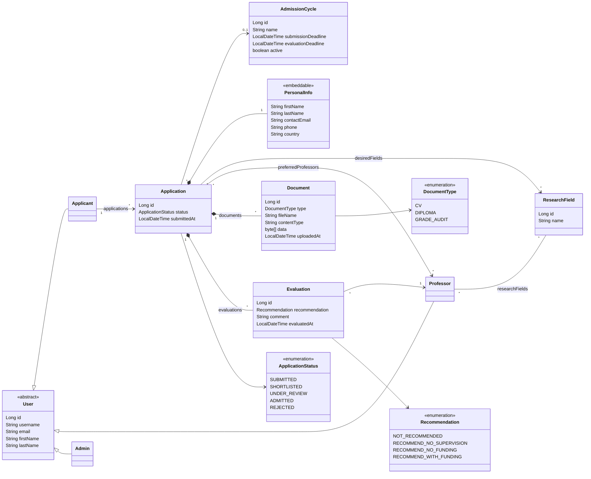
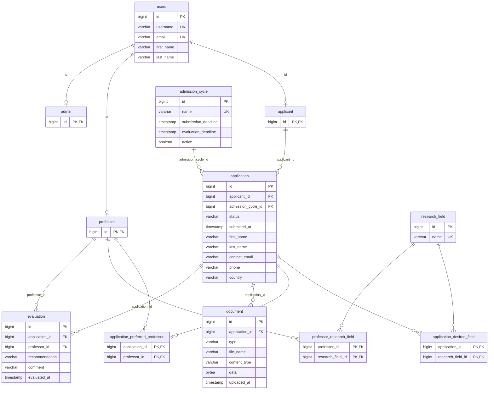

# SYSC 4806 Group Project: Graduate Admissions System

A Spring MVC web app for graduate school admissions. Applicants submit an application with their documents, research interests and their preferred supervisors. Professors can then review applications within their research fields and proceed to give a recommendation. Admins run each admission cycle and make the final call. 

Contributors include:

Qurb E Muhammad Syed
Alexander Gardiner
Sanil Srivastava
Ahmed Al-Khazaali


| | |
|---|---|
| **Production** | TBD |
| **Kanban** | [Projects tab](https://github.com/sanil04/SYSC-4806-Group-Project/projects) |
| **CI / deploys** | [Actions tab](https://github.com/sanil04/SYSC-4806-Group-Project/actions) |

**Stack:** Java 21, Spring Boot (Spring MVC, Thymeleaf, Spring Data JPA, Bean Validation), H2 for local dev and tests, PostgreSQL in production, Azure App Service, GitHub Actions.

---

## Current status

_Mirrors the Kanban. Updated at the end of each sprint._

| Item | Status |
|---|---|
| Repo, CI, branch protection, Kanban | Done |
| Azure App Service + CD (Hello World live) | In progress |
| Domain model: User hierarchy, ResearchField | Backlog |
| Domain model: Application, AdmissionCycle | Backlog |
| Domain model: Document, Evaluation | Backlog |
| Seed data | Backlog |
| Use case: applicant submits an application | Backlog |
| Use case: admin views submitted applications | Backlog |
| README: UML + schema | In progress |

## Sprint plan

### Sprint 1: Milestone 1, early prototype (demo Nov 12)

Goal: one use case working end to end, deployed on Azure.

> An applicant fills in the application form (personal info, desired research fields, preferred professors). It's validated and saved. An admin opens the applications list and sees it, with a detail page per application.

Supporting work: entities and repositories for the full model, seed data (research fields, professors, an active admission cycle), unit tests per layer and one integration test covering submit → list.

### Sprint 2: Milestone 2, alpha (demo Nov 26)

_Finalized at the end of Sprint 1._ Candidates:
- Document upload (CV, diploma, grade audit) and download
- Professor dashboard: applications matching their research fields
- Professor evaluations with a recommendation and comment
- Admin status changes: shortlist, admit, reject
- Enforce admission-cycle deadlines on submit and evaluate

---

## Domain model (UML)

Models only. Whoever changes an entity updates this diagram **in the same PR**.

> **Status:** planned model for Sprint 1. Each model PR brings its classes in line with the code.



### ORM patterns

| Pattern | Where | Why |
|---|---|---|
| Class Table Inheritance (`@Inheritance(JOINED)`) | `users` + `applicant`, `professor`, `admin` tables. Each subclass PK is also an FK to `users.id` | Subclasses have their own relationships and NOT NULL columns. SINGLE_TABLE can't enforce NOT NULL on subclass columns. TABLE_PER_CLASS turns polymorphic queries into a UNION and can't use IDENTITY ids. Cost: one join per subclass load. |
| Association Table Mapping (`@ManyToMany` + `@JoinTable`) | `professor_research_field`, `application_desired_field`, `application_preferred_professor` | Many-to-many needs a join table with a composite PK. |
| Foreign Key Mapping (`@ManyToOne` / `@OneToMany(mappedBy)`) | `application.applicant_id`, `document.application_id`, `evaluation.application_id`, `evaluation.professor_id` | The "many" side owns the FK column. |
| Embedded Value (`@Embeddable`) | `PersonalInfo` columns stored in `application` | Value object with no identity of its own. |
| Identity Field (`GenerationType.IDENTITY`) | Every root entity | Surrogate keys generated by the database. |
| Enum mapping (`@Enumerated(STRING)`) | status, type, recommendation | Reordering an enum can't corrupt stored rows. Hibernate adds a CHECK constraint. |

## Database schema

Generated by Hibernate from the entities. The production schema uses the PostgreSQL dialect.

> **Status:** target schema for the Sprint 1 model. Replace with the generated DDL as model PRs merge (see below).



**Regenerating the DDL** after a model change (writes `docs/schema.sql`):

```bash
mvn -q package -DskipTests
java -jar target/*.jar \
  --spring.main.web-application-type=none \
  --spring.jpa.hibernate.ddl-auto=none \
  --spring.jpa.database-platform=org.hibernate.dialect.PostgreSQLDialect \
  --spring.jpa.properties.jakarta.persistence.schema-generation.scripts.action=create \
  --spring.jpa.properties.jakarta.persistence.schema-generation.scripts.create-target=docs/schema.sql
```

---

## Build and run

Requires JDK 21 and Maven 3.9+.

```bash
git clone https://github.com/sanil04/SYSC-4806-Group-Project.git
cd SYSC-4806-Group-Project
mvn clean package          # compile, run all tests, build the JAR in target/
java -jar target/*.jar     # http://localhost:8080
```

Local runs use in-memory H2, so no database setup is needed. Browse the data at http://localhost:8080/h2-console (JDBC URL `jdbc:h2:mem:admissions`, user `sa`, empty password).

Tests only: `mvn verify`

### Production configuration

The `prod` profile (`application-prod.properties`) switches to PostgreSQL. Credentials are read from environment variables set in Azure App Service, never committed:

| Variable | Value |
|---|---|
| `SPRING_PROFILES_ACTIVE` | `prod` |
| `DB_URL` | `jdbc:postgresql://<server>.postgres.database.azure.com:5432/admissions?sslmode=require` |
| `DB_USERNAME` | database user |
| `DB_PASSWORD` | database password |

## How we work

1. Take an issue from **Backlog**, assign yourself, move it to **In Progress**.
2. Branch from `main`: `git checkout -b feature/<issue#>-short-name`
3. Open a PR with `Closes #<issue>` and request **2 reviewers**.
4. `main` is protected. Merging needs 2 approvals and a green CI run (`mvn verify`).
5. The author merges their own PR. Each merge to `main` triggers a deploy to Azure, so every member deploys. Target: 2-3 deploys per week.
6. If you changed a model, update the UML and schema above in the same PR.

**Weekly scrum:** one member opens an issue titled `Weekly scrum – YYYY-MM-DD`. Everyone comments with *Done this week / Next week / Blockers*, linking issues by number.

This README was edited partly with the use of AI (Claude Opus 5.5).