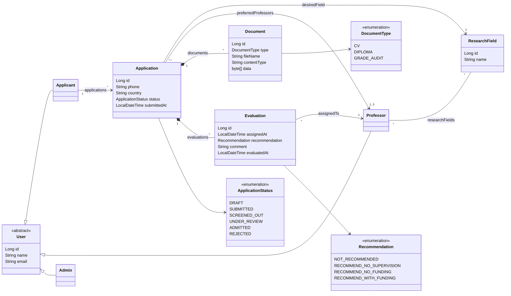
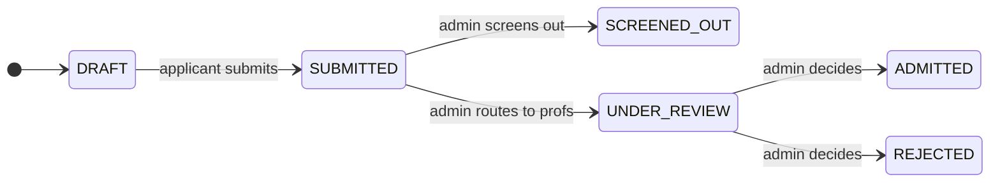
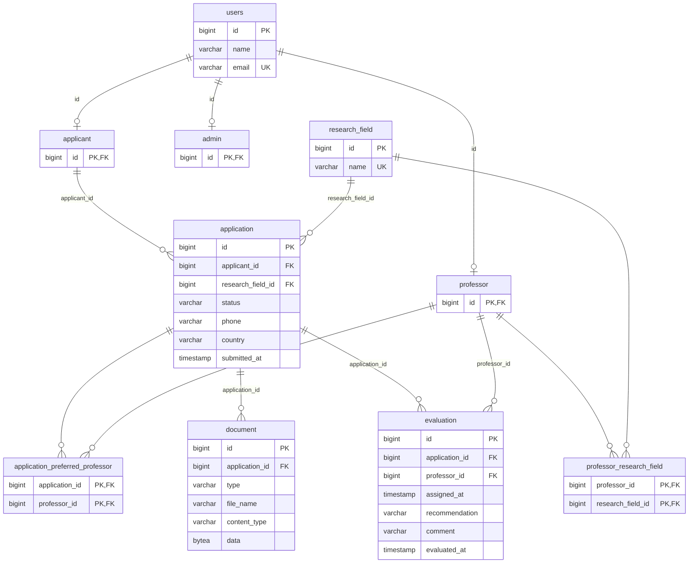

# Graduate Admissions Management System


Contributors include:

1) Qurb E Muhammad Syed
2) Alexander Gardiner
3) Sanil Srivastava
4) Ahmed Al-Khazaali


SYSC 4806 term project (topic 7). A Spring MVC web app for graduate admissions:

- **Applicants** submit a file with personal info, a desired research field, 1-3 preferred professors and documents (CV, diploma, grade audit) before the submission deadline.
- **Professors** keep a profile listing their research fields. They're emailed when applicants are routed to them, then enter an assessment before the evaluation deadline.
- **Admins** screen applications, route the good ones to professors, read the recommendations and make the final decision.

| | |
|---|---|
| **Production** | TBA |
| **Kanban** | [Projects tab](https://github.com/sanil04/SYSC-4806-Group-Project/projects) |
| **CI / deploys** | [Actions tab](https://github.com/sanil04/SYSC-4806-Group-Project/actions) |

**Stack:** Java 21, Spring Boot 4.1 (Spring MVC, Thymeleaf + Bootstrap, Spring Data JPA, Bean Validation). H2 locally and in tests, managed PostgreSQL on Azure in production. Spring Security and Spring Mail come in Sprint 2. Deployed to Azure App Service by GitHub Actions.

---

## Current status

_Mirrors the Kanban. Updated at the end of each sprint._

| Issue | Item | Status |
|---|---|---|
| #1 | Spring Boot project with Maven | Done |
| #2 | CI with GitHub Actions | In progress |
| #3 | Deploy to Azure App Service | In progress |
| #4 | Production database | Backlog |
| #5 | Branch protection + Kanban | In progress |
| #6 | README skeleton | In review |
| #7 | Domain entities | Backlog |
| #10 | Professor profile | Backlog |
| #11 | Application form | Backlog |
| #12 | Admin application list | Backlog |
| #13 | Home page and navigation | Backlog |

## Sprint plan

### Sprint 1: Milestone 1, early prototype (demo Nov 12)

Goal: one use case working end to end, deployed on Azure.

> A professor sets up their profile with research fields. An applicant fills in the application, picks that professor, and submits. The admin opens the applications list and sees it.

There's no login in Sprint 1. Users are seeded, and the home page has a role picker (Applicant / Professor / Admin).

Supporting work: the entities and seed data, CI on every PR, a deploy on every merge to `main`, unit tests per controller, and one end-to-end test (submit an application, then see it in the admin list).

### Sprint 2: Milestone 2, alpha (demo Nov 26)

_Finalized at the end of Sprint 1._ Candidates:
- Login and role-based access with Spring Security
- Document upload and download (CV, diploma, grade audit)
- Admin screening (screen out or move to review) and routing to professors
- Email notification to professors when applicants are routed to them
- Professor assessment form
- Submission and evaluation deadlines enforced

---

## Domain model (UML)

Models only. Whoever changes an entity updates this diagram **in the same PR**.

> **Status:** planned model from the design doc. No entities exist in the code yet. The #7 PR replaces this with the exact fields as built.



**Status flow.** Only the admin changes an application's status:



An `Evaluation` row is created when the admin routes an application to a professor. Its `recommendation` stays empty until the professor submits an assessment. A professor's assessment never changes the application's status.

### ORM patterns

| Pattern | Where | Why |
|---|---|---|
| Class Table Inheritance (`@Inheritance(JOINED)`) | `users` + `applicant`, `professor`, `admin` tables. Each subclass PK is also an FK to `users.id` | Subclasses have their own relationships. SINGLE_TABLE can't put NOT NULL on subclass-only columns. TABLE_PER_CLASS makes polymorphic queries a UNION. Cost: one join per subclass load. |
| Association Table Mapping (`@ManyToMany` + `@JoinTable`) | `professor_research_field`, `application_preferred_professor` | Many-to-many needs a join table with a composite PK. |
| Foreign Key Mapping (`@ManyToOne` / `@OneToMany(mappedBy)`) | `application.applicant_id`, `application.research_field_id`, `document.application_id`, `evaluation.application_id`, `evaluation.professor_id` | The "many" side owns the FK column. |
| Identity Field (`GenerationType.IDENTITY`) | Every root entity | Surrogate keys generated by the database. |
| Enum mapping (`@Enumerated(STRING)`) | status, document type, recommendation | Reordering an enum can't corrupt stored rows. |

## Database schema

> **Status:** target schema for the planned model. Once #7 merges, replace it with the DDL Hibernate actually generates (command below).



**Generating the real DDL** after a model change (PostgreSQL dialect, writes `docs/schema.sql`):

```bash
./mvnw -q package -DskipTests
java -jar target/gradadmissions-0.0.1-SNAPSHOT.jar \
  --spring.main.web-application-type=none \
  --spring.jpa.hibernate.ddl-auto=none \
  --spring.jpa.database-platform=org.hibernate.dialect.PostgreSQLDialect \
  --spring.jpa.properties.jakarta.persistence.schema-generation.scripts.action=create \
  --spring.jpa.properties.jakarta.persistence.schema-generation.scripts.create-target=docs/schema.sql
```

---

## Build and run

Requires JDK 21 or newer. Maven isn't needed: the repo includes the Maven wrapper.

```bash
git clone https://github.com/sanil04/SYSC-4806-Group-Project.git
cd SYSC-4806-Group-Project
./mvnw clean package                                  # Windows: .\mvnw.cmd clean package
java -jar target/gradadmissions-0.0.1-SNAPSHOT.jar    # http://localhost:8080
```

`./mvnw clean package` compiles the code, runs all tests and builds the runnable JAR. To run the tests only, use `./mvnw verify`.

Local runs use an in-memory H2 database, so there's nothing to set up. Data resets on every restart.

**Production:** the managed PostgreSQL database and its Spring profile are tracked in #4. Credentials will be set as Azure App Service environment variables, never committed.

## How we work

1. Take an issue from **Backlog**, assign yourself, move it to **In Progress**.
2. Branch from `main`, one branch per issue: `git checkout -b feature/<issue#>-short-name`
3. Open a PR with `Closes #<issue>` and request **2 reviewers**.
4. `main` is protected. Merging needs 2 approvals and a green CI run.
5. The author merges their own PR. Each merge to `main` deploys to Azure, so every member deploys. Target: 2-3 deploys per week.
6. If you change a model, update the UML and schema above in the same PR.
7. Commit messages follow [Conventional Commits](https://www.conventionalcommits.org): `feat:`, `fix:`, `test:`, `docs:`, `ci:`, `build:`, `refactor:`, `chore:`.

**Weekly scrum:** one member opens an issue titled `Weekly scrum – YYYY-MM-DD`. Everyone comments with *Done this week / Next week / Blockers*, linking issues by number.