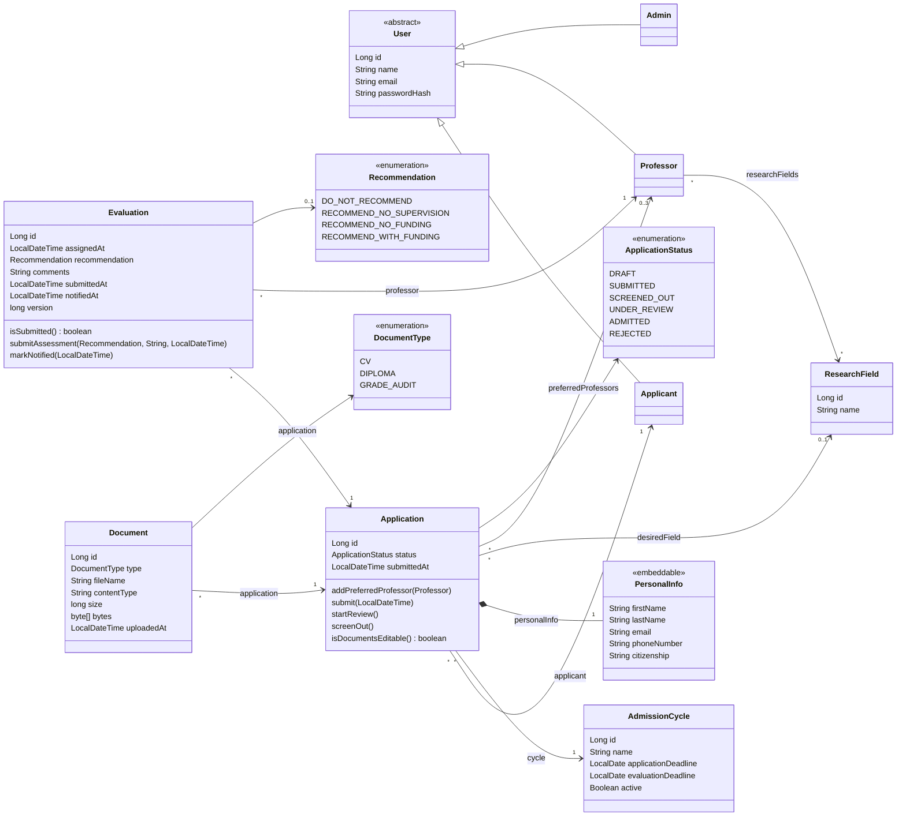
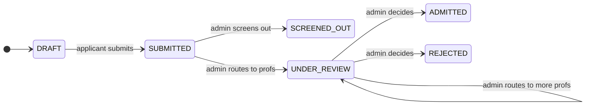
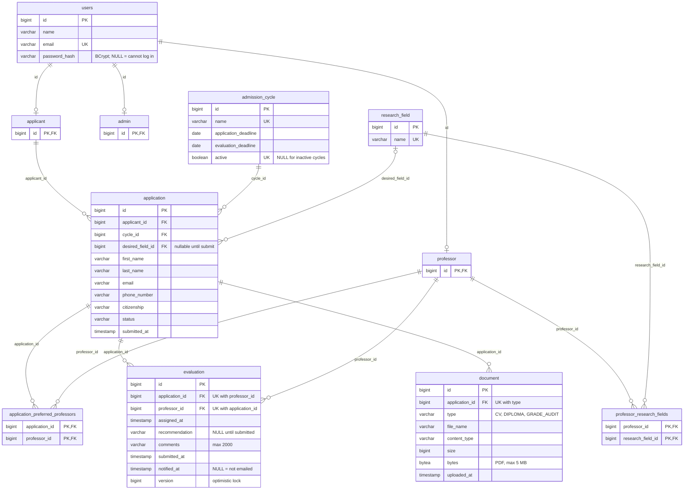

# Graduate Admissions Management System


| Contributor | GitHub |
|---|---|
| Qurb E Muhammad Syed | [@SyedQem](https://github.com/SyedQem) |
| Alexander Gardiner | [@asgardiner](https://github.com/asgardiner) |
| Sanil Srivastava | [@sanil04](https://github.com/sanil04) |
| Ahmed Al-Khazaali | [@ahmedalkhazaali](https://github.com/ahmedalkhazaali) |
| Sanidhya | [@sanizzz](https://github.com/sanizzz) |

SYSC 4806 term project (topic 7). A Spring MVC web app for graduate admissions:

- **Applicants** submit a file with personal info, a desired research field, 1-3 preferred professors and documents (CV, diploma, grade audit) before the submission deadline.
- **Professors** keep a profile listing their research fields. They're emailed when applicants are routed to them, then enter an assessment before the evaluation deadline.
- **Admins** screen applications, route the good ones to professors, read the recommendations and make the final decision.

| | |
|---|---|
| **Production** | <https://sysc4806-gradadmissions-fxe8abasgfd9b6ea.francecentral-01.azurewebsites.net/> |
| **Kanban** | [Projects tab](https://github.com/sanil04/SYSC-4806-Group-Project/projects) |
| **CI / deploys** | [Actions tab](https://github.com/sanil04/SYSC-4806-Group-Project/actions) |
| **Weekly scrums** | [Issues titled "Weekly scrum"](https://github.com/sanil04/SYSC-4806-Group-Project/issues?q=is%3Aissue+%22Weekly+scrum%22) |

**Stack:** Java 21, Spring Boot 4.1 (Spring MVC, Thymeleaf, Spring Data JPA / Hibernate 7, Bean Validation). H2 in memory locally and in tests; Azure Database for PostgreSQL in production. Deployed to Azure App Service by GitHub Actions on every merge to `main`. Spring Security (form login, BCrypt, role-based URL rules). Spring Mail with a Resilience4j circuit breaker for emails to professors.

---

## Current status

_Mirrors the Kanban. Last updated at the end of Sprint 2 (Milestone 2, Nov 26)._

The full review loop works end to end in production, behind a login (see [Demo logins](#demo-logins)): **an applicant applies with documents (or saves a draft), the admin filters, screens and routes the application, each professor is emailed, opens it and submits an assessment, and the admin sees the recommendations.** Each role sees only its own section. Still to come in Sprint 3: the admin's final decision, deadlines and the applicant status page.

### What you can do on the live site

| Page | Who | What it does |
|---|---|---|
| `/` | Everyone | Home page: **Log in** and **Create an account** cards, or once logged in, a link to your section |
| `/register` | Everyone | Applicants create an account: name, email (unique across all accounts) and password. Then they log in |
| `/login` | Everyone | Log in with email and password. The nav shows who is logged in and a **Log out** button |
| `/professor/profiles` | Professor | List of professors; open one to view it. On your own profile, **Edit profile** changes your name, email and research fields |
| `/professor/applications` | Professor | Applications routed to you; open one to read it, download its documents and submit your assessment |
| `/apply` | Applicant | Application form for the logged-in applicant: personal info (name and email filled in from the account; the email can't be changed), a research field, and 1-3 professors (the list is filtered by the chosen field). **Save draft** keeps it to finish later; one application per cycle |
| `/apply/{id}/documents` | Applicant | Upload your CV, diploma and grade audit (PDF, up to 5 MB each) |
| `/apply/confirmation/{id}` | Applicant | Confirmation shown after submitting. Only your own application; anyone else's gives 404 |
| `/admin/applications` | Admin | Submitted applications, newest first, filterable by field, professor, status and date. Open one to read it and its documents, route it to professors or screen it out, and see each professor's assessment |
| `/admin/professors/new` | Admin | Create a professor account with a temporary password |

Seeded data (created on startup if missing): research fields AI, Software Engineering, Networks and Security; an admin; professors Alice Chen, Brian Okonkwo and Carla Rossi; a demo applicant; and the active "Fall 2027" admission cycle (applications accepted until 2027-01-15).

**Access rules** ([`SecurityConfig`](src/main/java/com/sysc4806/gradadmissions/config/SecurityConfig.java)):

| URL | Who can open it |
|---|---|
| `/`, `/login`, `/register`, `/css/**`, `/error` | Everyone |
| `/admin/**` | Admins |
| `/professor/**` | Professors. A professor can view every profile but edit only their own. |
| `/applicant`, `/apply/**` | Applicants |
| `/documents/{id}` | The owning applicant, admins, or professors assigned to the application; other logged-in users get 403 |
| Anything else | Any logged-in user |

Visitors who aren't logged in are sent to `/login`, then back to the page they asked for. A logged-in user who opens another role's page gets a 403 "Access denied" page. Every POST needs the CSRF token, which Thymeleaf adds to `th:action` forms automatically. In code, `CurrentUserService` returns the logged-in `Admin`, `Professor` or `Applicant`.

### Sprint 1 issues

| Issue | Item | Status |
|---|---|---|
| #1 | Spring Boot project with Maven | Done |
| #2 | CI with GitHub Actions | Done |
| #3 | Deploy to Azure App Service on every merge to `main` | Done |
| #4 | Production PostgreSQL database and Spring profiles | Done |
| #5 | Branch protection and Kanban | Done |
| #6 | README skeleton | Done |
| #7 | Domain entities and repositories | Done |
| #8 | UML class diagram and DB schema in the README | Done |
| #9 | Seed research fields, admin and professors | Done |
| #10 | Professor profile: view and edit research fields | Done |
| #11 | Applicant: submit an application | Done |
| #12 | Admin: list and detail of submitted applications | Done |
| #13 | Home page and navigation | Done |
| #14 | End-to-end test: submit an application, then see it in the admin list | Done |
| #24 | Seed an active admission cycle | Done |
| #15 | Weekly scrum | Ongoing |
| #16 | Prepare the Milestone 1 demo | In progress |

### Sprint 2 issues

| Issue | Item | Status |
|---|---|---|
| #32 | `Evaluation` model: routing and assessments | Done |
| #33 | Login and role-based access with Spring Security | Done |
| #34 | Upload CV, diploma and grade audit | Done |
| #35 | Seeder fix when the "Fall 2027" cycle is inactive | Done |
| #36 | Restrict production deploys and secrets to `main` | Done |
| #37 | Applicant registration; applications linked to the logged-in applicant | Done |
| #38 | Admin creates professor accounts | Done |
| #39 | Admin routes an application or screens it out | Done |
| #40 | Admin filters the application list | Done |
| #41 | Professor: assigned applications and detail | Done |
| #42 | Professor submits an assessment | Done |
| #43 | At least one research field on a professor profile | Done |
| #44 | Protected document downloads | Done |
| #45 | Drafts and one application per cycle | Done |
| #46 | End-to-end test: apply, route, evaluate, see the recommendation | In review (#65) |
| #49 | Email professors behind a circuit breaker | Done |
| #47 | Weekly scrum | Ongoing |
| #48 | Prepare the Milestone 2 demo | In progress |

**Tests:** 254, all run by `./mvnw clean package` and by CI on every pull request: repository tests (`@DataJpaTest`), service tests, controller tests (`@WebMvcTest`), and full-application tests (`@SpringBootTest`) that use the real seeded data, including the end-to-end test (#14), real logins with the seeded accounts, and a per-role access check of every section (#33).

## Sprint plan

### Sprint 1: Milestone 1, early prototype (Nov 12) — done

Goal: one use case working end to end, deployed on Azure. Delivered as described in [Current status](#current-status), along with CI on every PR, a deploy on every merge to `main`, and a persistent PostgreSQL database in production.

### Sprint 2: Milestone 2, alpha (Nov 26) — done

Goal: the full review loop for one application, behind a login. An applicant logs in, applies with documents, the admin screens and routes the application, and the professor evaluates it.

| Feature | Requirements (design doc) |
|---|---|
| Login and role-based access with Spring Security (applicant registration, seeded professors and admin) | FR-01, FR-02 |
| Admin creates professor accounts | FR-03 |
| Document upload and download (CV, diploma, grade audit; PDF up to 5 MB), visible only to the applicant, assigned professors and admins | FR-07 |
| Save an application as a draft and submit it later | FR-08 |
| Admin filters the application list by field, professor, status and date | FR-18 |
| Admin routes an application to professors, or screens it out | FR-19, FR-20 |
| Professor sees their assigned applications, opens one, and submits an assessment | FR-12, FR-13, FR-14 |

New models: `Document` and `Evaluation` (assignment plus assessment), added to the UML and schema below in the same PRs.

Also in Sprint 2, from Sprint 1 reviews:
- Stop duplicate submissions by the same applicant in the same cycle.
- Make the seeder safe when the "Fall 2027" cycle exists but is inactive (it would currently fail on the unique cycle name at startup).
- Require at least one research field on a professor profile.
- Restrict the `production` GitHub environment, and its deploy secrets, to `main`.

Also done: emailing professors when an application is routed to them, behind a circuit breaker (#49, see [Resilience](#resilience-email-behind-a-circuit-breaker)).

### Sprint 3: Milestone 3, final demo (Dec 10)

Goal: the product is complete. The admin compares the professors' assessments and makes the final decision, deadlines are enforced, and the applicant can follow their application to the decision. No links to unbuilt features.

| Issue | Feature | Who |
|---|---|---|
| #67 | Admin sees the assessments side by side and admits or rejects | Ahmed |
| #68 | Enforce the evaluation deadline and show both deadlines | Alexander |
| #69 | Applicant status page: application, documents and decision | Qurb E |
| #70 | Fixes from Sprint 2 reviews | Sanil |
| #71 | End-to-end test: register, apply, route, assess, decide | Sanidhya |
| #72 | Final UI pass: no dangling links or placeholder text | Sanidhya |
| #73, #74 | Weekly scrums (Dec 3, Dec 10) | Everyone |
| #75 | Prepare the final demo and README | Everyone |

New field: the decision date on `Application` (#67), added to the UML and schema in the same PR.

---

## Domain model (UML)

Models only. Whoever changes an entity updates this diagram **in the same PR**.

> **Status:** matches the entities in `src/main/java/com/sysc4806/gradadmissions/model`, including `Evaluation`, `Recommendation`, `Document` and `DocumentType`.



**Login and roles:** the role isn't a column. It's the `User` subclass (`Admin`, `Professor`, `Applicant`), which `security/Role` maps to `ROLE_ADMIN`, `ROLE_PROFESSOR` or `ROLE_APPLICANT`. `passwordHash` is nullable because production uses `ddl-auto=update`, which can't add a NOT NULL column to a table that already has rows.

**Rules enforced in `Application`:**
- At most 3 preferred professors (`MAX_PREFERRED_PROFESSORS`). This is our team's assumption: the project description only says "a list of profs", so the limit is one constant if we change it.
- A draft can be missing its desired field and professors. `submit()` requires a `DRAFT` with a desired field and at least one professor, and accepts submissions through the cycle's deadline date.
- `PersonalInfo` is embedded, so its fields are columns in the `application` table rather than a separate table.
- `startReview()` (the admin routes it to professors) needs `SUBMITTED` or `UNDER_REVIEW`: an application under review can be routed to more professors. `screenOut()` needs `SUBMITTED`, so an application already sent to professors can't be screened out.

**Rules enforced in `Evaluation`:**
- One evaluation per (application, professor) pair, enforced by a unique constraint, so an application can't be routed to the same professor twice.
- `recommendation` is null until the professor submits. `submitAssessment()` needs a recommendation, accepts optional comments (at most 2000 characters, blank stored as null), and can run only once.

**Status flow.** Only the admin changes an application's status:



The admin sets `UNDER_REVIEW` and `SCREENED_OUT` from the application's detail page (#39). `ADMITTED` and `REJECTED` are in the enum, but the final decision comes in Sprint 3. When the admin routes an application to a professor, an `Evaluation` row is created. Its `recommendation` stays empty until the professor submits an assessment, and a professor's assessment never changes the application's status.

### ORM patterns

| Pattern | Where | Why |
|---|---|---|
| Class Table Inheritance (`@Inheritance(JOINED)`) | `users` + `applicant`, `professor`, `admin` tables. Each subclass PK is also an FK to `users.id` | Subclasses have their own relationships. SINGLE_TABLE can't put NOT NULL on subclass-only columns. TABLE_PER_CLASS makes polymorphic queries a UNION. Cost: one join per subclass load. |
| Association Table Mapping (`@ManyToMany` + `@JoinTable`) | `professor_research_fields`, `application_preferred_professors` | Many-to-many needs a join table with a composite PK. |
| Foreign Key Mapping (`@ManyToOne`) | `application.applicant_id`, `application.cycle_id`, `application.desired_field_id`, `evaluation.application_id`, `evaluation.professor_id` | The "many" side owns the FK column. |
| Embedded Value (`@Embeddable` / `@Embedded`) | `PersonalInfo` columns inside `application` | A value object with no identity of its own, so it doesn't need its own table. |
| Identity Field (`GenerationType.IDENTITY`) | Every root entity | Surrogate keys generated by the database. |
| Enum mapping (`@Enumerated(STRING)`) | `application.status`, `evaluation.recommendation` | Reordering an enum can't corrupt stored rows. |

## Database schema

The full PostgreSQL DDL is in [`docs/schema.sql`](docs/schema.sql). In production, Hibernate updates these tables in Azure PostgreSQL from the entities (`ddl-auto=update`).



**Generating the real DDL** after a model change (PostgreSQL dialect, writes `docs/schema.sql`):

```bash
./mvnw -q package -DskipTests
java -jar target/gradadmissions-0.0.1-SNAPSHOT.jar \
  --spring.main.web-application-type=none \
  --spring.jpa.hibernate.ddl-auto=none \
  --spring.jpa.database-platform=org.hibernate.dialect.PostgreSQLDialect \
  --spring.jpa.properties.jakarta.persistence.schema-generation.scripts.action=create \
  --spring.jpa.properties.jakarta.persistence.schema-generation.scripts.create-target=docs/schema.sql
```

---

## Resilience: email behind a circuit breaker

_Presentation topic 6 (Circuit Breaker Pattern), built in #49._

After the admin routes an application, `NotificationService` emails each professor a link to their assigned applications. Each send goes through a Resilience4j `CircuitBreaker` ([`NotificationConfig`](src/main/java/com/sysc4806/gradadmissions/config/NotificationConfig.java)):

- **CLOSED:** emails are sent. **OPEN:** once at least half of the last 5 sends (3 or more) failed, sends are skipped for 60 s. **HALF_OPEN:** then one trial send closes or reopens it.
- Emails go out after the routing commits and failures are never thrown, so routing always stands. Unsent emails leave `notified_at` empty ("Not sent" on the admin page). SMTP timeouts are 3 s.
- The breaker state is shown on **Admin → Applications**. We use Resilience4j's core library because Hystrix is in maintenance mode and doesn't support Spring Boot 3+.
- With no `SPRING_MAIL_HOST` set, emails are only logged. Pointing it at a server that doesn't answer is an easy way to demo the breaker opening.

## Application document uploads

After saving a draft, applicants can open **Application documents** to upload their files before submitting.
Each application has one CV, diploma and grade audit. Files must be PDFs up to 5 MB; uploading the same type replaces the previous file. Documents become read-only when the application is submitted, and the upload form is hidden. The bytes and metadata stay in the database across redeploys.
Only the owning applicant can list or upload documents at `/apply/{id}/documents`. Download links appear on the applicant, admin and assigned professor application pages. `/documents/{id}` sends the PDF as an attachment and allows only the owning applicant, admins and professors with an evaluation for the application. Other logged-in users get 403. Downloads use `Cache-Control: no-store`.
Oversized uploads get a 413 response with the size limit. Simultaneous first uploads keep one file and show a retry message for the conflicting upload.

## Build and run

Requires JDK 21 or newer. Maven isn't needed: the repo includes the Maven wrapper.

```bash
git clone https://github.com/sanil04/SYSC-4806-Group-Project.git
cd SYSC-4806-Group-Project
./mvnw clean package                                  # Windows: .\mvnw.cmd clean package
java -jar target/gradadmissions-0.0.1-SNAPSHOT.jar    # http://localhost:8080
```

`./mvnw clean package` compiles the code, runs all tests and builds the runnable JAR. To run the tests only, use `./mvnw verify`.

Local runs use an in-memory H2 database, so there's nothing to set up. Data resets on every restart.

### Demo logins

Every page except the home page, `/login` and `/register` needs a login. These accounts are created on startup, locally and in production:

| Role | Email | Password |
|---|---|---|
| Admin | `admin@gradadmissions.local` | `admin123` |
| Professor | `achen@gradadmissions.local` (also `bokonkwo@…`, `crossi@…`) | `prof123` |
| Applicant | `applicant@gradadmissions.local` | `applicant123` |

Passwords are stored as BCrypt hashes in `users.password_hash`. The seeder only sets a password on a seeded account that has none, so it never resets a changed password. Applicants created by the application form before login existed have no password and can't log in.

New applicants register at `/register` (#37). Their email is stored in lower case, and login ignores case. Professor and admin accounts can't be registered this way.

## Deployment

```
pull request ──► CI: ./mvnw verify ──► 2 approvals ──► merge to main ──► CI build ──► deploy job ──► Azure App Service
```

- **CI** ([`.github/workflows/ci.yml`](.github/workflows/ci.yml)) runs `./mvnw -B verify` (compile, all tests, package) on every pull request and every push to `main`. The `main` ruleset requires the `build` check and 2 approving reviews before merging, and blocks force pushes.
- **Deploy:** after a green build on `main`, the `deploy` job uploads the same JAR to Azure with `azure/webapps-deploy`, using the `production` GitHub environment. Every deploy is listed under **Deployments** on the repo page. A deploy can also be re-run from **Actions → CI → Run workflow**.
- **App Service:** `sysc4806-gradadmissions`, Linux, Java 21 (Java SE), Basic B1 plan, France Central. App setting `SERVER_PORT=80`. Azure's own "Continuous deployment" is off: GitHub Actions does the deploys.

### Production database

| | |
|---|---|
| Server | Azure Database for PostgreSQL Flexible Server `sysc4806-gradadmissions-db` (PostgreSQL 17, Burstable B1ms), same resource group and region as the App Service |
| Database | `gradadmissions` |
| Network | Public access limited to firewall rules: one per App Service outbound IPv4 address |
| Connection | TLS with full certificate verification (`sslmode=verify-full`) |
| Schema | Created and updated by Hibernate on startup (`ddl-auto=update`), so data survives restarts and redeploys |

The `prod` Spring profile ([`application-prod.properties`](src/main/resources/application-prod.properties)) reads its connection from App Service app settings. Credentials are never committed.

| App setting | Value |
|---|---|
| `SPRING_PROFILES_ACTIVE` | `prod` |
| `DB_URL` | `jdbc:postgresql://sysc4806-gradadmissions-db.postgres.database.azure.com:5432/gradadmissions` |
| `DB_USERNAME` / `DB_PASSWORD` | The server's PostgreSQL login (stored only in App Service) |

Verified on Nov 12 (#4): the app starts on the `prod` profile and connects; the seeded rows are in `users` and `research_field`; an application submitted on the live site appears in the admin list; and the data is still there after restarting the App Service.

**Inspecting the database:** add your IP under the server's **Networking → Firewall rules** (it changes between networks), then connect with SSL required, for example with IntelliJ's Database tool. Ask the Azure account owner for the credentials.

```sql
SELECT id, email FROM users ORDER BY id;
SELECT id, name FROM research_field ORDER BY id;
```

**Rebuilding it from scratch:** create the Flexible Server and the `gradadmissions` database; add a firewall rule for each IP in the App Service's `possibleOutboundIpAddresses`; set the app settings above; apply, and check **Monitoring → Log stream** for `profile is active: "prod"` and `HikariPool-1 - Start completed`. See Azure's docs on [app settings](https://learn.microsoft.com/en-us/azure/app-service/configure-common?tabs=portal) and [firewall rules](https://learn.microsoft.com/en-us/azure/postgresql/security/security-firewall-rules).

## How we work

1. Take an issue from **Backlog**, assign yourself, move it to **In Progress**.
2. Branch from `main`, one branch per issue, starting with the issue number: `git checkout -b 12-admin-list-<yourname>`
3. Open a PR with `Closes #<issue>` and request **2 reviewers**.
4. `main` is protected. Merging needs 2 approvals and a green CI run.
5. The author merges their own PR. Each merge to `main` deploys to Azure, so every member deploys. Target: 2-3 deploys per week.
6. If you change a model, update the UML and schema above in the same PR.
7. Commit messages follow [Conventional Commits](https://www.conventionalcommits.org): `feat:`, `fix:`, `test:`, `docs:`, `ci:`, `build:`, `refactor:`, `chore:`.

**Weekly scrum:** one member opens an issue titled `Weekly scrum – YYYY-MM-DD`. Everyone comments with *Done this week / Next week / Blockers*, linking issues by number.
