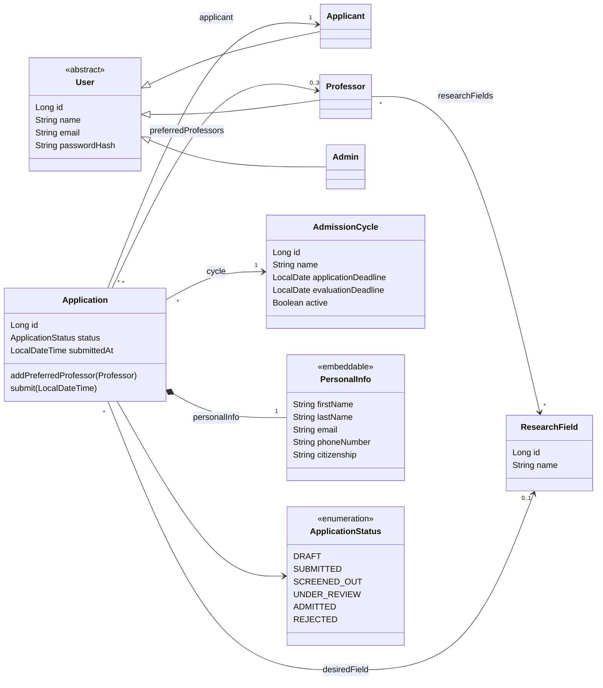
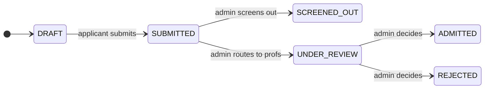
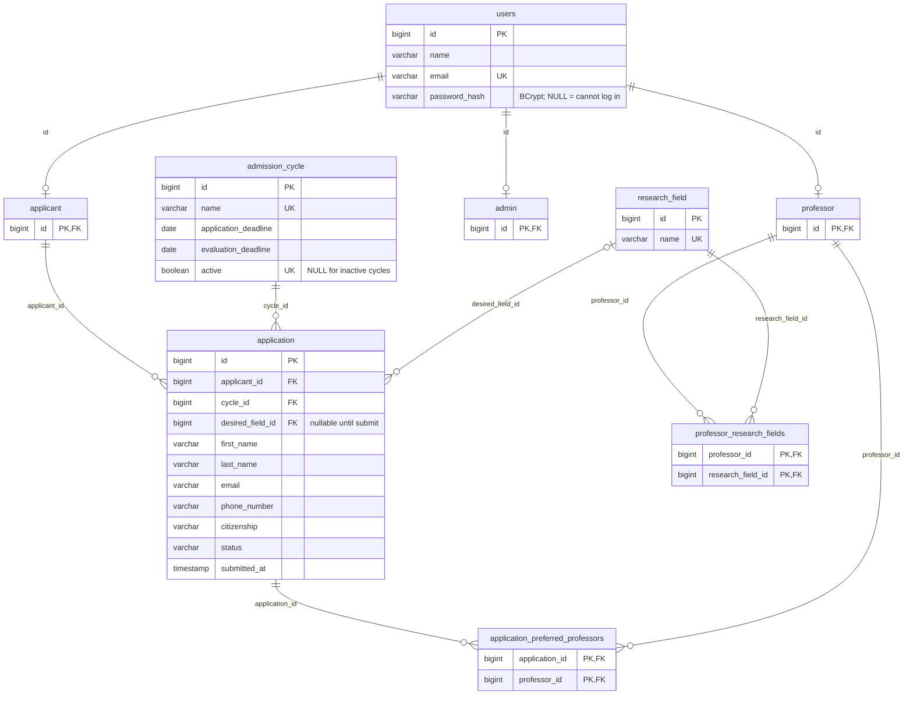

# Graduate Admissions Management System


| Contributor | GitHub |
|---|---|
| Qurb E Muhammad Syed | [@SyedQem](https://github.com/SyedQem) |
| Alexander Gardiner | [@asgardiner](https://github.com/asgardiner) |
| Sanil Srivastava | [@sanil04](https://github.com/sanil04) |
| Ahmed Al-Khazaali | [@ahmedalkhazaali](https://github.com/ahmedalkhazaali) |
| Sanidhya | [@sanizzz](https://github.com/sanizzz) |

SYSC 4806 term project (topic 7). A Spring MVC web app for graduate admissions:

- **Applicants** submit a file with personal info, a desired research field, 1-3 preferred professors and documents (CV, diploma, grade audit) before the submission deadline.
- **Professors** keep a profile listing their research fields. They're emailed when applicants are routed to them, then enter an assessment before the evaluation deadline.
- **Admins** screen applications, route the good ones to professors, read the recommendations and make the final decision.

| | |
|---|---|
| **Production** | <https://sysc4806-gradadmissions-fxe8abasgfd9b6ea.francecentral-01.azurewebsites.net/> |
| **Kanban** | [Projects tab](https://github.com/sanil04/SYSC-4806-Group-Project/projects) |
| **CI / deploys** | [Actions tab](https://github.com/sanil04/SYSC-4806-Group-Project/actions) |
| **Weekly scrums** | [Issues titled "Weekly scrum"](https://github.com/sanil04/SYSC-4806-Group-Project/issues?q=is%3Aissue+%22Weekly+scrum%22) |

**Stack:** Java 21, Spring Boot 4.1 (Spring MVC, Thymeleaf, Spring Data JPA / Hibernate 7, Bean Validation). H2 in memory locally and in tests; Azure Database for PostgreSQL in production. Deployed to Azure App Service by GitHub Actions on every merge to `main`. Spring Security and Spring Mail come in Sprint 2.

---

## Current status

_Mirrors the Kanban. Last updated at the end of Sprint 1 (Milestone 1, Nov 12)._

Sprint 1's use case works end to end in production: **a professor sets their research fields, an applicant applies choosing that professor, and the admin sees the application.** There is no login yet; the home page links to the Applicant, Professor and Admin sections.

### What you can do on the live site

| Page | What it does |
|---|---|
| `/` | Home page with links to the three sections |
| `/professor/profiles` | List of professors; open one to view it, then **Edit profile** to change name, email and research fields |
| `/apply` | Application form: personal info, a research field, and 1-3 professors (the list is filtered by the chosen field) |
| `/apply/confirmation/{id}` | Confirmation shown after submitting |
| `/admin/applications` | Table of submitted applications, newest first; open one for the full details |

Seeded data (created on startup if missing): research fields AI, Software Engineering, Networks and Security; an admin; professors Alice Chen, Brian Okonkwo and Carla Rossi; and the active "Fall 2027" admission cycle (applications accepted until 2027-01-15).

### Sprint 1 issues

| Issue | Item | Status |
|---|---|---|
| #1 | Spring Boot project with Maven | Done |
| #2 | CI with GitHub Actions | Done |
| #3 | Deploy to Azure App Service on every merge to `main` | Done |
| #4 | Production PostgreSQL database and Spring profiles | Done |
| #5 | Branch protection and Kanban | Done |
| #6 | README skeleton | Done |
| #7 | Domain entities and repositories | Done |
| #8 | UML class diagram and DB schema in the README | Done |
| #9 | Seed research fields, admin and professors | Done |
| #10 | Professor profile: view and edit research fields | Done |
| #11 | Applicant: submit an application | Done |
| #12 | Admin: list and detail of submitted applications | Done |
| #13 | Home page and navigation | Done |
| #14 | End-to-end test: submit an application, then see it in the admin list | Done |
| #24 | Seed an active admission cycle | Done |
| #15 | Weekly scrum | Ongoing |
| #16 | Prepare the Milestone 1 demo | In progress |

**Tests:** 63, all run by `./mvnw clean package` and by CI on every pull request: repository tests (`@DataJpaTest`), service tests, controller tests (`@WebMvcTest`), and full-application tests (`@SpringBootTest`) that use the real seeded data, including the end-to-end test (#14).

## Sprint plan

### Sprint 1: Milestone 1, early prototype (Nov 12) — done

Goal: one use case working end to end, deployed on Azure. Delivered as described in [Current status](#current-status), along with CI on every PR, a deploy on every merge to `main`, and a persistent PostgreSQL database in production.

### Sprint 2: Milestone 2, alpha (Nov 26)

Goal: the full review loop for one application, behind a login. An applicant logs in, applies with documents, the admin screens and routes the application, and the professor evaluates it.

| Feature | Requirements (design doc) |
|---|---|
| Login and role-based access with Spring Security (applicant registration, seeded professors and admin) | FR-01, FR-02 |
| Admin creates professor accounts | FR-03 |
| Document upload and download (CV, diploma, grade audit; PDF up to 5 MB), visible only to the applicant, assigned professors and admins | FR-07 |
| Save an application as a draft and submit it later | FR-08 |
| Admin filters the application list by field, professor, status and date | FR-18 |
| Admin routes an application to professors, or screens it out | FR-19, FR-20 |
| Professor sees their assigned applications, opens one, and submits an assessment | FR-12, FR-13, FR-14 |

New models: `Document` and `Evaluation` (assignment plus assessment), added to the UML and schema below in the same PRs.

Also in Sprint 2, from Sprint 1 reviews:
- Stop duplicate submissions by the same applicant in the same cycle.
- Make the seeder safe when the "Fall 2027" cycle exists but is inactive (it would currently fail on the unique cycle name at startup).
- Require at least one research field on a professor profile.
- Restrict the `production` GitHub environment, and its deploy secrets, to `main`.

Planned for Sprint 3: email notifications to professors, enforced submission and evaluation deadlines, admin side-by-side view of assessments and final decision, and applicant status page.

---

## Domain model (UML)

Models only. Whoever changes an entity updates this diagram **in the same PR**.

> **Status:** matches the entities built in #7 (`src/main/java/com/sysc4806/gradadmissions/model`). `Document` and `Evaluation` are still planned and are added by the issues that need them.



**Login and roles:** the role isn't a column. It's the `User` subclass (`Admin`, `Professor`, `Applicant`), which `security/Role` maps to `ROLE_ADMIN`, `ROLE_PROFESSOR` or `ROLE_APPLICANT`. `passwordHash` is nullable because production uses `ddl-auto=update`, which can't add a NOT NULL column to a table that already has rows.

**Rules enforced in `Application`:**
- At most 3 preferred professors (`MAX_PREFERRED_PROFESSORS`). This is our team's assumption: the project description only says "a list of profs", so the limit is one constant if we change it.
- A draft can be missing its desired field and professors. `submit()` requires a `DRAFT` with a desired field and at least one professor, and accepts submissions through the cycle's deadline date.
- `PersonalInfo` is embedded, so its fields are columns in the `application` table rather than a separate table.

**Status flow.** Only the admin changes an application's status:



`SCREENED_OUT` through `REJECTED` are in the enum now, but the admin actions that set them come in later issues. The planned design: an `Evaluation` row is created when the admin routes an application to a professor, its `recommendation` stays empty until the professor submits an assessment, and a professor's assessment never changes the application's status.

### ORM patterns

| Pattern | Where | Why |
|---|---|---|
| Class Table Inheritance (`@Inheritance(JOINED)`) | `users` + `applicant`, `professor`, `admin` tables. Each subclass PK is also an FK to `users.id` | Subclasses have their own relationships. SINGLE_TABLE can't put NOT NULL on subclass-only columns. TABLE_PER_CLASS makes polymorphic queries a UNION. Cost: one join per subclass load. |
| Association Table Mapping (`@ManyToMany` + `@JoinTable`) | `professor_research_fields`, `application_preferred_professors` | Many-to-many needs a join table with a composite PK. |
| Foreign Key Mapping (`@ManyToOne`) | `application.applicant_id`, `application.cycle_id`, `application.desired_field_id` | The "many" side owns the FK column. |
| Embedded Value (`@Embeddable` / `@Embedded`) | `PersonalInfo` columns inside `application` | A value object with no identity of its own, so it doesn't need its own table. |
| Identity Field (`GenerationType.IDENTITY`) | Every root entity | Surrogate keys generated by the database. |
| Enum mapping (`@Enumerated(STRING)`) | `application.status` | Reordering an enum can't corrupt stored rows. |

## Database schema

> **Status:** generated by Hibernate from the current entities (PostgreSQL dialect); regenerated on Nov 18 for `users.password_hash` (#33). The full DDL is in [`docs/schema.sql`](docs/schema.sql). In production, Hibernate creates the same tables in Azure PostgreSQL from these entities (`ddl-auto=update`).



**Generating the real DDL** after a model change (PostgreSQL dialect, writes `docs/schema.sql`):

```bash
./mvnw -q package -DskipTests
java -jar target/gradadmissions-0.0.1-SNAPSHOT.jar \
  --spring.main.web-application-type=none \
  --spring.jpa.hibernate.ddl-auto=none \
  --spring.jpa.database-platform=org.hibernate.dialect.PostgreSQLDialect \
  --spring.jpa.properties.jakarta.persistence.schema-generation.scripts.action=create \
  --spring.jpa.properties.jakarta.persistence.schema-generation.scripts.create-target=docs/schema.sql
```

---

## Build and run

Requires JDK 21 or newer. Maven isn't needed: the repo includes the Maven wrapper.

```bash
git clone https://github.com/sanil04/SYSC-4806-Group-Project.git
cd SYSC-4806-Group-Project
./mvnw clean package                                  # Windows: .\mvnw.cmd clean package
java -jar target/gradadmissions-0.0.1-SNAPSHOT.jar    # http://localhost:8080
```

`./mvnw clean package` compiles the code, runs all tests and builds the runnable JAR. To run the tests only, use `./mvnw verify`.

Local runs use an in-memory H2 database, so there's nothing to set up. Data resets on every restart.

### Demo logins

Every page except the home page and `/login` needs a login. These accounts are created on startup, locally and in production:

| Role | Email | Password |
|---|---|---|
| Admin | `admin@gradadmissions.local` | `admin123` |
| Professor | `achen@gradadmissions.local` (also `bokonkwo@…`, `crossi@…`) | `prof123` |
| Applicant | `applicant@gradadmissions.local` | `applicant123` |

Passwords are stored as BCrypt hashes in `users.password_hash`. The seeder only sets a password on a seeded account that has none, so it never resets a changed password. Applicants created by the application form before login existed have no password and can't log in. Applicant registration comes in #37.

## Deployment

```
pull request ──► CI: ./mvnw verify ──► 2 approvals ──► merge to main ──► CI build ──► deploy job ──► Azure App Service
```

- **CI** ([`.github/workflows/ci.yml`](.github/workflows/ci.yml)) runs `./mvnw -B verify` (compile, all tests, package) on every pull request and every push to `main`. The `main` ruleset requires the `build` check and 2 approving reviews before merging, and blocks force pushes.
- **Deploy:** after a green build on `main`, the `deploy` job uploads the same JAR to Azure with `azure/webapps-deploy`, using the `production` GitHub environment. Every deploy is listed under **Deployments** on the repo page. A deploy can also be re-run from **Actions → CI → Run workflow**.
- **App Service:** `sysc4806-gradadmissions`, Linux, Java 21 (Java SE), Basic B1 plan, France Central. App setting `SERVER_PORT=80`. Azure's own "Continuous deployment" is off: GitHub Actions does the deploys.

### Production database

| | |
|---|---|
| Server | Azure Database for PostgreSQL Flexible Server `sysc4806-gradadmissions-db` (PostgreSQL 17, Burstable B1ms), same resource group and region as the App Service |
| Database | `gradadmissions` |
| Network | Public access limited to firewall rules: one per App Service outbound IPv4 address |
| Connection | TLS with full certificate verification (`sslmode=verify-full`) |
| Schema | Created and updated by Hibernate on startup (`ddl-auto=update`), so data survives restarts and redeploys |

The `prod` Spring profile ([`application-prod.properties`](src/main/resources/application-prod.properties)) reads its connection from App Service app settings. Credentials are never committed.

| App setting | Value |
|---|---|
| `SPRING_PROFILES_ACTIVE` | `prod` |
| `DB_URL` | `jdbc:postgresql://sysc4806-gradadmissions-db.postgres.database.azure.com:5432/gradadmissions` |
| `DB_USERNAME` / `DB_PASSWORD` | The server's PostgreSQL login (stored only in App Service) |

Verified on Nov 12 (#4): the app starts on the `prod` profile and connects; the seeded rows are in `users` and `research_field`; an application submitted on the live site appears in the admin list; and the data is still there after restarting the App Service.

**Inspecting the database:** add your IP under the server's **Networking → Firewall rules** (it changes between networks), then connect with SSL required, for example with IntelliJ's Database tool. Ask the Azure account owner for the credentials.

```sql
SELECT id, email FROM users ORDER BY id;
SELECT id, name FROM research_field ORDER BY id;
```

**Rebuilding it from scratch:** create the Flexible Server and the `gradadmissions` database; add a firewall rule for each IP in the App Service's `possibleOutboundIpAddresses`; set the app settings above; apply, and check **Monitoring → Log stream** for `profile is active: "prod"` and `HikariPool-1 - Start completed`. See Azure's docs on [app settings](https://learn.microsoft.com/en-us/azure/app-service/configure-common?tabs=portal) and [firewall rules](https://learn.microsoft.com/en-us/azure/postgresql/security/security-firewall-rules).

## How we work

1. Take an issue from **Backlog**, assign yourself, move it to **In Progress**.
2. Branch from `main`, one branch per issue, starting with the issue number: `git checkout -b 12-admin-list-<yourname>`
3. Open a PR with `Closes #<issue>` and request **2 reviewers**.
4. `main` is protected. Merging needs 2 approvals and a green CI run.
5. The author merges their own PR. Each merge to `main` deploys to Azure, so every member deploys. Target: 2-3 deploys per week.
6. If you change a model, update the UML and schema above in the same PR.
7. Commit messages follow [Conventional Commits](https://www.conventionalcommits.org): `feat:`, `fix:`, `test:`, `docs:`, `ci:`, `build:`, `refactor:`, `chore:`.

**Weekly scrum:** one member opens an issue titled `Weekly scrum – YYYY-MM-DD`. Everyone comments with *Done this week / Next week / Blockers*, linking issues by number.